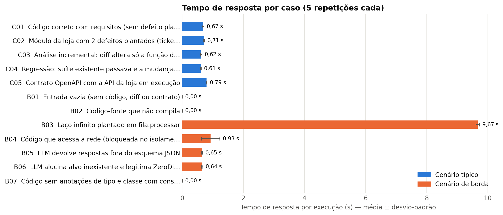
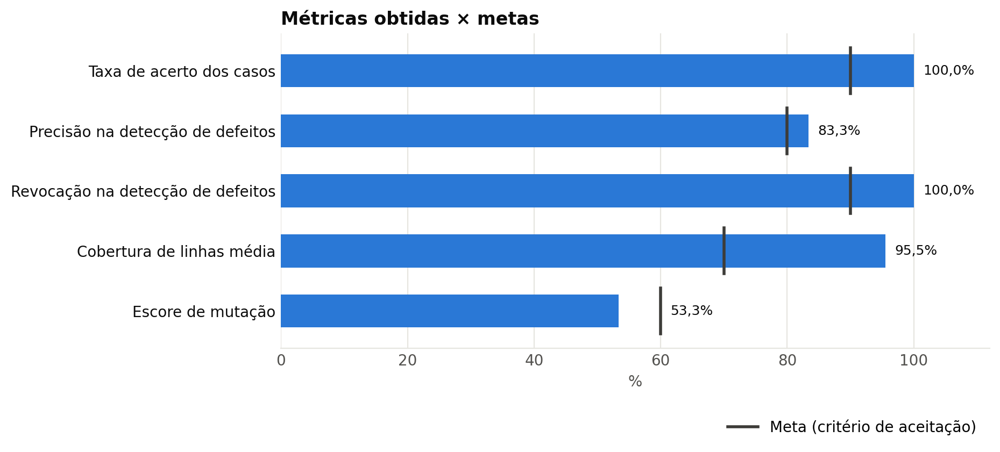
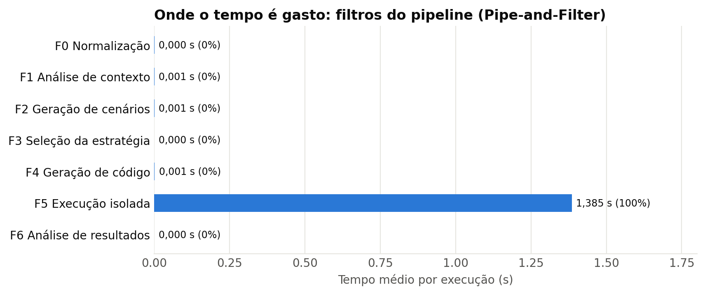
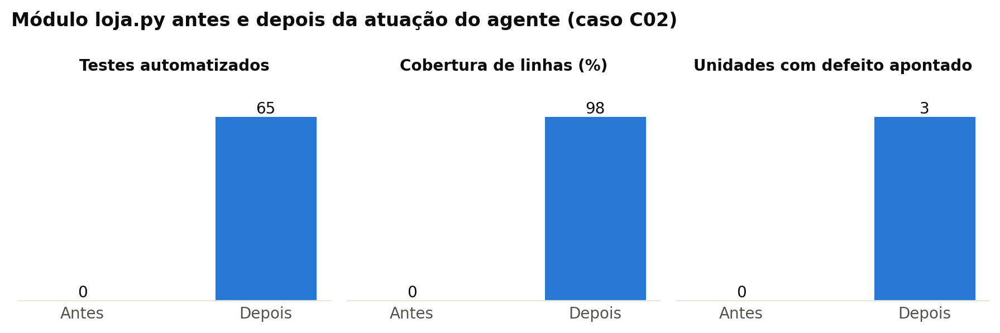
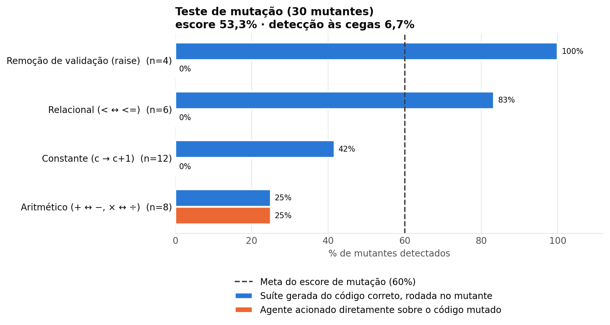

# Resultados da avaliação — Agente de Testes de Software

Gerado por `agente-testes avaliar` em 2026-11-12 10:13:50 · modo `heuristico` · executor `docker` · 5 repetições por caso · limite por teste 3 s · Python 3.9.6 · modelo(s): nenhum (modo heurístico), simulado (roteirizado).

## Casos de teste executados (12: 5 típicos, 7 de borda)

| Nº | Cenário testado | Resultado esperado | Resultado obtido |
|---|---|---|---|
| 1 (C01) | [típico] Código correto com requisitos (sem defeito plantado) | Portão aprovado, nenhum achado de defeito e cobertura ≥ 70% | Portão aprovado; 22 testes (22 aprovados); nenhum achado; cobertura 100%. ✔ conforme o esperado (5/5 repetições) |
| 2 (C02) | [típico] Módulo da loja com 2 defeitos plantados (ticket_medio, aplicar_cupom) | Os 2 defeitos plantados apontados e portão reprovado | Portão reprovado; 65 testes; defeitos apontados em Estoque.adicionar, aplicar_cupom, ticket_medio; cobertura 98%. ✔ conforme o esperado (5/5 repetições) |
| 3 (C03) | [típico] Análise incremental: diff altera só a função dividir | Cenários apenas para dividir e portão aprovado | Unidades com cenários: calc.dividir; 9 testes; portão aprovado. ✔ conforme o esperado (5/5 repetições) |
| 4 (C04) | [típico] Regressão: suíte existente passava e a mudança a quebrou | Achado “regressao” em test_dobro e portão reprovado | Regressão apontada em tests.test_calc::test_dobro; portão reprovado; regressao×1. ✔ conforme o esperado (5/5 repetições) |
| 5 (C05) | [típico] Contrato OpenAPI com a API da loja em execução | Testes de API gerados do contrato, executados contra a API e aprovados | 1 arquivo(s) de teste de API; 4/4 requisições conforme o contrato; portão aprovado. ✔ conforme o esperado (5/5 repetições) |
| 6 (B01) | [borda] Entrada vazia (sem código, diff ou contrato) | Rejeição na validação do contrato, sem executar o pipeline | Rejeitada na validação do contrato (ValidationError: informe ao menos 'arquivos', 'diff' ou 'contrato_openapi'); pipeline não executado. ✔ conforme o esperado (5/5 repetições) |
| 7 (B02) | [borda] Código-fonte que não compila | Risco ALTA “não compila”, nenhum teste e portão reprovado | Risco ALTA “não compila” registrado; 0 testes; portão reprovado. ✔ conforme o esperado (5/5 repetições) |
| 8 (B03) | [borda] Laço infinito plantado em fila.processar | Testes interrompidos pelo limite por teste, achado “tempo_esgotado” e portão reprovado | 3 teste(s) interrompido(s) por tempo em fila.processar; portão reprovado. ✔ conforme o esperado (5/5 repetições) |
| 9 (B04) | [borda] Código que acessa a rede (bloqueada no isolamento) | Achado “dependencia_externa”, nenhum falso defeito e portão reprovado | 2 achado(s) dependencia_externa; 0 unidade(s) apontada(s) como defeito; portão reprovado. ✔ conforme o esperado (5/5 repetições) |
| 10 (B05) | [borda] LLM devolve respostas fora do esquema JSON | Respostas rejeitadas, queda para heurística e pipeline concluído | Respostas do LLM rejeitadas pelo esquema; cenários de origem heuristica; 22 testes; portão aprovado. ✔ conforme o esperado (5/5 repetições) |
| 11 (B06) | [borda] LLM alucina alvo inexistente e legitima ZeroDivisionError | Alvo inexistente descartado, exceção acidental rejeitada e defeito apontado | Alvo inexistente descartado; ZeroDivisionError rejeitado como hipótese; defeito em media apontado; portão reprovado. ✔ conforme o esperado (5/5 repetições) |
| 12 (B07) | [borda] Código sem anotações de tipo e classe com construtor com argumentos | Risco de testabilidade registrado; portão não aprova sem evidência executada | Risco de testabilidade registrado; 0 testes; portão reprovado (nenhum teste executado). ✔ conforme o esperado (5/5 repetições) |

## Métricas e estatísticas coletadas

| Métrica | Valor obtido | Meta/critério de aceitação |
|---|---|---|
| Taxa de acerto (casos com resultado obtido = esperado) | 100,0% (12/12 casos; 60 execuções) | ≥ 90% — atingida |
| Precisão na detecção de defeitos | 83,3% (VP=25, FP=5) | ≥ 80% — atingida |
| Tempo médio de resposta (por execução do pipeline) | 1,28 s ± 2,57 s (IC 95%: ± 0,65 s; mediana 0,65 s; p95 9,63 s) | ≤ 60 s — atingida |
| Revocação (sensibilidade) na detecção de defeitos | 100,0% (VP=25, FN=0) | ≥ 90% — atingida |
| F1 (média harmônica de precisão e revocação) | 90,9% | — (derivada) |
| Falso positivo em código correto | 0,0% das 35 execuções sem defeito plantado | = 0% — atingida |
| Cobertura de linhas dos testes gerados | 95,5% em média (mín. 83,3%, máx. 100,0%) | ≥ 70% — atingida |
| Testes gerados e executados por execução | 13,0 em média (mín. 0, máx. 65) | — (descritiva) |
| Escore de mutação (defeitos injetados detectados) | 53,3% (16/30 mutantes) | ≥ 60% — não atingida |
| Detecção às cegas (agente acionado sobre o código já mutado) | 6,7% (2/30 mutantes reprovados) | — (diagnóstico do oráculo, sem meta prévia) |

## Linha para a Consolidação Estatística Geral (seção 4 do modelo)

| Agente | Nº de testes | Taxa de sucesso | Tempo médio (s) |
|---|---|---|---|
| Agente de Testes de Software | 12 casos (60 execuções) | 100,0% | 1,28 |

## Detalhe do teste de mutação (`corpus/precos.py`)

| Mutante | Operador | Linha | Alteração | Suíte gerada do código correto | Agente às cegas |
|---|---|---|---|---|---|
| M01 | RVR | 6 | `if valor < 0:  →  validação removida (raise → pass)` | morto (1/26 testes falharam) | **aprovou** |
| M02 | ROR | 6 | `valor < 0  →  valor <= 0` | morto (1/26 testes falharam) | **aprovou** |
| M03 | CRP | 6 | `0  →  1` | morto (1/26 testes falharam) | **aprovou** |
| M04 | RVR | 8 | `if percentual < 0 or percentual > 100:  →  validação removida (raise → pass)` | morto (2/26 testes falharam) | **aprovou** |
| M05 | ROR | 8 | `percentual < 0  →  percentual <= 0` | morto (1/26 testes falharam) | **aprovou** |
| M06 | CRP | 8 | `0  →  1` | morto (1/26 testes falharam) | **aprovou** |
| M07 | ROR | 8 | `percentual > 100  →  percentual >= 100` | morto (1/26 testes falharam) | **aprovou** |
| M08 | CRP | 8 | `100  →  101` | morto (1/26 testes falharam) | **aprovou** |
| M09 | AOR | 10 | `valor * (1 - percentual / 100)  →  valor / (1 - percentual / 100)` | morto (1/26 testes falharam) | reprovou (defeito_suspeito) |
| M10 | AOR | 10 | `1 - percentual / 100  →  1 + percentual / 100` | **sobreviveu** | **aprovou** |
| M11 | CRP | 10 | `1  →  2` | **sobreviveu** | **aprovou** |
| M12 | AOR | 10 | `percentual / 100  →  percentual * 100` | **sobreviveu** | **aprovou** |
| M13 | CRP | 10 | `100  →  101` | **sobreviveu** | **aprovou** |
| M14 | RVR | 15 | `if peso_kg <= 0:  →  validação removida (raise → pass)` | morto (1/26 testes falharam) | **aprovou** |
| M15 | ROR | 15 | `peso_kg <= 0  →  peso_kg < 0` | morto (1/26 testes falharam) | **aprovou** |
| M16 | CRP | 15 | `0  →  1` | morto (1/26 testes falharam) | **aprovou** |
| M17 | RVR | 17 | `if distancia_km < 0:  →  validação removida (raise → pass)` | morto (1/26 testes falharam) | **aprovou** |
| M18 | ROR | 17 | `distancia_km < 0  →  distancia_km <= 0` | morto (1/26 testes falharam) | **aprovou** |
| M19 | CRP | 17 | `0  →  1` | morto (1/26 testes falharam) | **aprovou** |
| M20 | AOR | 19 | `10 + 0.5 * peso_kg + 0.1 * distancia_km  →  10 + 0.5 * peso_kg - 0.1 * distancia_km` | **sobreviveu** | **aprovou** |
| M21 | AOR | 19 | `10 + 0.5 * peso_kg  →  10 - 0.5 * peso_kg` | **sobreviveu** | **aprovou** |
| M22 | CRP | 19 | `10  →  11` | **sobreviveu** | **aprovou** |
| M23 | AOR | 19 | `0.5 * peso_kg  →  0.5 / peso_kg` | **sobreviveu** | **aprovou** |
| M24 | CRP | 19 | `0.5  →  1.5` | **sobreviveu** | **aprovou** |
| M25 | AOR | 19 | `0.1 * distancia_km  →  0.1 / distancia_km` | morto (2/26 testes falharam) | reprovou (defeito_suspeito) |
| M26 | CRP | 19 | `0.1  →  1.1` | **sobreviveu** | **aprovou** |
| M27 | ROR | 20 | `peso_kg > 30  →  peso_kg >= 30` | **sobreviveu** | **aprovou** |
| M28 | CRP | 20 | `30  →  31` | **sobreviveu** | **aprovou** |
| M29 | AOR | 21 | `frete *= 1.2  →  frete /= 1.2` | **sobreviveu** | **aprovou** |
| M30 | CRP | 21 | `1.2  →  2.2` | **sobreviveu** | **aprovou** |

## Gráficos

